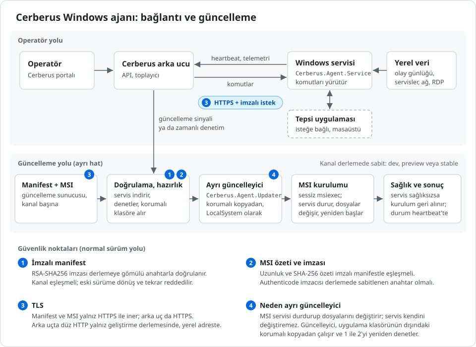

# Cerberus Windows Agent

Windows bilgisayarlarını ve sunucularını Cerberus'a bağlayan ajan. Cihazı kaydeder, durumunu ve envanterini bildirir, yetkili komutları uygular ve kendi güncellemesini yönetir. Cerberus ve Bilnex entegrasyonları aynı ajan ve güncelleme yolunu kullanır.

[](https://github.com/BUZASLAN128/cerberus-windows-agent/actions/workflows/ci.yml)
[](https://github.com/BUZASLAN128/cerberus-windows-agent/releases/latest)

[İndirilen paketler](https://github.com/BUZASLAN128/cerberus-windows-agent/releases) · [Katkı rehberi](CONTRIBUTING.md) · [Güvenlik bildirimi](SECURITY.md) · [Destek](SUPPORT.md) · [Kabul prosedürü](docs/AGENTS_ACCEPTANCE_GUIDE.md)

## Mimari



[Çizimi tam boy aç](docs/diagrams/agent-architecture.svg)

### Ajan neden gerekli?

Yönetim paneli tek başına bir Windows makinesinin servislerini, olay günlüklerini, kurulu yazılımlarını veya güncelleme sonucunu okuyamaz. Ajan bu yerel bilgileri toplar ve cihazın kayıtlı kimliğiyle backend'e iletir. Backend'den gelen izinli işlemleri de Windows üzerinde uygular ve sonucunu geri bildirir.

Arka plandaki Windows hizmeti sayesinde kullanıcı oturumu veya açık bir panel olmasa da heartbeat, telemetri ve güncelleme takibi sürer. Masaüstü arayüzü kullanıcı etkileşimini sağlar; sunucu profilinde bu arayüz bulunmaz.

### Hangi parça ne işe yarar?

| Parça | Görevi | Neden ayrı? |
|---|---|---|
| Portal ve backend / collector | Cihaz kaydı, politika, komut teslimi, telemetri ve sonuçların merkezi görünümü | Operatörün yetkisi ve cihazın kimliği merkezi olarak değerlendirilir. |
| `Cerberus.Agent.exe` | Desktop tray/panel, kayıt ve destek CLI'ı | Kullanıcı arayüzü ile arka plan hizmetinin yaşam döngüleri ayrıdır. |
| `Cerberus.Agent.Service.exe` | Heartbeat, telemetri, komut işleme ve kalıcı güncelleme durumu | Kullanıcı oturumundan bağımsız çalışır; makineye ait işlemleri sahiplenir. |
| `Cerberus.Agent.Updater.exe` | Doğrulanmış güncelleme denemesini ayrı süreçte yürütür | Güncellenen hizmet durduğunda kurulum takibinin devam etmesi gerekir. |
| MSI ve installer helper | Dosyaların kurulması, servis işlemleri, kurulum/sağlık kayıtları ve rollback sınırı | Windows Installer işlemi ile ajanın kendi süreçleri birbirinden ayrılır. |
| `Cerberus.Agent.Uninstall.exe` | Kaldırma akışı; ulaşabildiğinde backend'deki kaydı da kapatma | Yerel kaldırma ile uzak kayıt sonucunu birlikte yönetir. |
| Core, Security ve entegrasyon kütüphaneleri | Protokol, kimlik/imza, korumalı depolama ve Windows yetenekleri | Ortak kodun UI, hizmet ve yardımcı süreçlerde tutarlı kullanılmasını sağlar. |

Kütüphaneler ayrı çalışan servisler değildir. `Cerberus.Agent.Runtime` ortak kaynak dosyalarını hizmet, updater ve uninstall projelerine bağlar. Desktop paneli yerel hizmete yetki denetimli kontrol kanalı üzerinden erişir.

## Desktop ve Server profilleri

Profil **derleme sırasında** seçilir. Backend politikası veya sonradan değiştirilen bir ayar Desktop paketini Server paketine dönüştürmez.

| | Desktop — varsayılan | Server |
|---|---|---|
| Ürün / hizmet | Cerberus Windows Agent / `CerberusAgent` | Cerberus Server Agent / `CerberusServerAgent` |
| Kullanım | Kullanıcı bilgisayarı | Arayüz gerektirmeyen sunucu |
| Kayıt | Panelden tarayıcıyla Casdoor PKCE oturumu | İlk MSI kurulumunda tek kullanımlık enrollment proof |
| Arayüz | Tray ve kontrol paneli | Yok |
| Snapshot varsayılanı / sınırı | 60 sn / 60 sn–24 saat | 3600 sn / 300–3600 sn |
| Paket adı eki | Ek yok | `-server` |
| Veri dizini | `%ProgramData%\CerberusAgent` | `%ProgramData%\CerberusServerAgent` |

Kurulum dizini Desktop için `%ProgramFiles%\Cerberus\Windows Agent`, Server için `%ProgramFiles%\Cerberus\Server Agent`; çalıştırılabilir dosyalar bu dizinlerin `app` altındadır.

## Otomatik güncelleme nasıl çalışır?

1. **Kontrol:** Hizmet, yapılandırılmış kanaldaki manifesti okur. Kanal, sürüm, geçerlilik süresi, sıra numarası ve manifest imzası doğrulanır.
2. **İndirme:** İzin verilen HTTPS adresinden MSI indirilir. BITS aktarımı, TLS doğrulaması, imzalı `artifact_length` ve SHA-256 kontrolü uygulanır. Normal yayın kanalında paketin Authenticode yayıncı anahtarı da derlemedeki izin verilen anahtarla eşleşmelidir.
3. **Hazırlama:** Plan, manifest, paket ve deneme durumu korumalı güncelleme alanına kaydedilir. İndirme tamamlanması, kurulumun başladığı anlamına gelmez.
4. **Kurulum yetkisi:** Geçerli güncelleme politikası veya açık kurulum isteği uygun olduğunda hizmet ayrı updater sürecini başlatır. `agent.update.request` sunucu komutu bu isteği kalıcı olarak kaydeder; scheduler uygular.
5. **Uygulama:** Ayrı updater doğrulanmış MSI yolunu yürütür. Hizmetin değişmesi, kurulu sürüm ve sağlık sonucu bu akışta takip edilir. İşlem tamamlandığında updater kapanır.
6. **Sonuç ve toparlanma:** Kalıcı deneme kayıtları tekrar deneme ve kurulum uzlaştırmasında kullanılır. Hizmet sonucu backend'e yansıtır. Başarısız veya belirsiz durum başarı sayılmaz; uygulanabilir retry/rollback yolu ve mevcut yetki sınırları korunur.

**Kontrol etmek, indirmek ve kurmak farklı adımlardır.** Kurulum isteği ya da gerekli politika yoksa paket hazırlanmış halde bekleyebilir. Manifestin erişilebilir olması da yeterli değildir: içindeki MSI adresine hedef cihazın kendi ağından erişilebilmelidir.

Manifest v2'deki uzunluk, aktarım sırasında bilinen HTTP/BITS uzunluğuyla ve indirilen dosyayla eşleşmelidir. Fazla HTTP verisi yazılmadan reddedilir. İndirme öncesi boş alan kontrolü yapılır; bu kontrol MSI kurulumunun sonraki disk ihtiyacı için alan rezervasyonu değildir. Eski v1 manifest bu aktarım sözleşmesini karşılamaz.

### Gerçek güncelleme kabulü

Güncelleme davranışını etkileyen değişiklikler, sabit aday ve farklı sürüm varyantlarıyla owner PC ve test VM'nin **her birinde en az 10 ardışık, müdahalesiz self-update** üzerinden doğrulanır. Her geçiş kontrollü ajan/güncelleyici arızası ve otomatik toparlanma içermelidir. Elle bootstrap kurulumu, tekrar gönderilen komut veya elle servis düzeltme bu sayıya dahil değildir.

Bu kabul için kullanılan geliştirme kampanyası iki kayıt kimliğine, belirli sürümlere ve süreli politikaya bağlıdır. Normal kanal güveniyle aynı şey değildir; imzasız paketin genel dağıtımına veya normal kanal kontrollerinin kapatılmasına izin vermez. Kabul serisi, normal imzalı yayın kanalının hazırlanması ve o kanala dönüşün yerine geçmez.

Ayrıntılar: [güncelleme kabul prosedürü](docs/AGENTS_ACCEPTANCE_GUIDE.md).

## Kurulum

### Desktop

1. Uygun dağıtımın `Cerberus.Agent-<channel>-<version>.msi` paketini çalıştırın ve EULA'yı kabul edin.
2. Son sayfadan paneli açın veya kurulu `app\Cerberus.Agent.exe --open` komutunu kullanın.
3. Panelden oturum açın, cihazı kaydedin ve portal sahiplenmesini tamamlayın. Hizmet kurulumu/yönetimi gereken adımda Windows yönetici izni ister.

### Server

`Cerberus.Agent-<channel>-<version>-server.msi` paketini çalıştırın ve tek kullanımlık enrollment proof'u girin. MSI, ilk kurulumda headless kaydı ve hizmet kurulumunu yapar. Upgrade mevcut kaydı korur; yeniden ilk kayıt gibi davranmaz.

Her MSI için aynı taban ada sahip bir Burn `.exe` kurulum sarmalayıcısı da üretilebilir. Sarmalayıcı tam MSI'yı içerir; EULA/privacy ve Server kayıt ekranları MSI'ya aittir. **Ajanın kendi güncellemesi MSI kullanır.** Yönetilen sessiz kurulumlar, GPO/Intune ve MSI bakım işlemleri için de MSI kullanılmalıdır. Burn kaydının kurulu yaşam döngüsü ayrıca doğrulanmalıdır.

MSI özellikleri, proxy ve onay ayarları bu belgenin sonundaki [Yapılandırma ve ayarlar](#yapılandırma-ve-ayarlar) bölümündedir.

## Telemetri ve komutlar

### Telemetri

Hizmet, backend'in döndürdüğü aralığı profil sınırları içinde uygular ve snapshot zamanına ±%20 jitter ekler. İki profil de aynı 18 bölümü destekler:

`identity`, `os`, `resources`, `network`, `tailscale`, `rdp`, `firewall`, `security`, `clock`, `runtime`, `capabilities`, `sessions`, `hardware`, `services`, `listening_ports`, `updates`, `software`, `processes`.

Backend'in `snapshot_sections` ilanı gönderilecek alt kümeyi sınırlar. İlan yoksa eski Desktop 11 ve Server 15 bölümlük kümeler uygulanır; Secondary signed-facts yolu kendi 15 bölümlük kümesini korur.

Güvenlik verisi; protokol bazında başarısız girişleri, başarılı interaktif/RDP girişlerini, yerel yönetici üyeliğini/değişikliklerini, log temizlemeyi, beklenmeyen kapanmayı ve Defender/SMBv1 durumunu kapsar. SQL Server başarısız girişleri çalışan SQL Server hizmet süreciyle ilişkilendirilemediğinde `unverified` kalır. Parola ve süreç komut satırları toplanmaz; başarısız giriş denemeleri denenmiş kullanıcı adı olmadan bildirilir. Backend alınan telemetrinin saklama süresini yönetir.

Gönderilemeyen snapshot'lar `telemetry-offline.json` içinde tamponlanır. Giriş ve üyelik değişikliği gibi tek seferlik olaylar tekrar sayılmaması için tampon kopyalardan çıkarılır.

Desktop'ta yeni güvenlik giriş/yerel yönetici ayrıntıları için **makine kapsamında Privacy Notice v3 kabulü ve içerik özeti** gerekir. Tray/User kabulü bu makine kategorilerini açmaz. Kabul yokken önceki veri kapsamı, heartbeat ve komutlar sürer; yeni alanlar kullanılamaz. İmzalı JSON gönderiminden hemen önce onay yeniden denetlenir; kapalı alanlar çıkarılır ve bölüm hash'leri yeniden hesaplanır. Çelişen replay eski özel gövdeyle tekrar gönderilmez. Upgrade kendiliğinden yeni veri kategorilerine onay vermez.

Yerel yönetici ekleyen kişi/zaman, kurulum kaynağı ve firewall adapter profili gibi ayrıntılar yalnız yeterli kaynak kanıtı varsa doldurulur. Bilinmeyen veri tahmin edilmez; ağ profili açık firewall portlarının kanıtı değildir. Snapshot en fazla 100 yerel yönetici ve 16 aktif adapter profilini kapsar.

### Komutlar

| Profil | İşlemler |
|---|---|
| Her iki profil | `ping`, `collect_facts`, `agent_state` |
| Desktop | `agent.health.snapshot`, `agent.rdp.quick_test`, `agent.diagnostic_bundle.collect`, `agent.update.request`; etkin entegrasyonlara göre Tailscale, yerel kullanıcı ve AD kullanıcı işlemleri |
| Server | `agent.update.request` — yalnız `install` modu |

`collect_facts` tek telemetri toplamasını ister. Server komutları pakete gömülü güven anahtarlarıyla doğrulanan imzalı zarflardan gelir. AD işlemleri kısa ömürlü backend yetkisi gerektirir; yerel kullanıcı oluşturma cihaz ayarıyla ayrıca denetlenir.

Desteklenen kullanıcı işlemleri `windows.local_user.create` / `.disable` / `.delete` ve `windows.ad_user.create` / `.disable` / `.delete` adlarını kullanır. `tailscale.ensure_connected`, Tailscale kurulu fakat bağlı değilken backend'in o cihaza verdiği tek kullanımlık auth key ile bağlantı kurmayı dener.

## Kimlik, güven ve kalıcı durum

- Makine kaydı, tenant/cihaz kimliği, refresh token ve özel anahtar gibi korunan kayıtlar DPAPI ile saklanır. Makine kapsamındaki dosyaya SYSTEM ve Administrators erişir; kullanıcı kapsamındaki onboarding kaydı ilgili kullanıcıyı da kapsar.
- Heartbeat, telemetri ve komut ACK/sonuç istekleri bearer token ve cihaz imzası taşır. İlk kayıt, enrollment ve token yenileme kendi kimlik doğrulama akışlarını kullanır. Token sona ermeden yenilenir; nonce, zaman, gövde hash'i ve imza cihaz imzalı isteği kimliğe bağlar.
- Normal güncellemede manifest imzası, paket uzunluğu/hash'i, TLS ve izin verilen Authenticode yayıncı anahtarı birlikte denetlenir.
- Loglar `Sanitizer` üzerinden token, parola, özel anahtar, API key, authorization ve benzeri değerlerden arındırılır.
- Kayıtlı ajanın korumalı imzalı durum kaydı eksik veya okunamazsa yalnız credential bulunması yeterli kabul edilmez. Claim, quarantine/revoke ve sıra sınırı doğrulanmadan normal işlemler açılmaz.

<details>
<summary>İmzalı durum kurtarma ve API sözleşmesi</summary>

Upgrade mevcut v1 signed-state kaydını okur. `unreadable` reset işareti, DPAPI/dosya hatasının yanında eski ajanın hiç signed snapshot almamış olması anlamına da gelebilir.

Kurtarma sırasında heartbeat; `status=degraded`, `signed_state_reset=true`, `signed_state_floor` ve `signed_state_recovery_rejections` bildirir. Normal heartbeat reset=false ve floor=0 gönderir; süreç boyunca tutulan ret sayacı korunur. `agent_runtime` tüketicileri temizlenmiş değerleri de işlemelidir.

Kurtarma tamamlanmadan gelen yeni sıradan zarflar handler'a verilmez; `state_recovery_required` gerekçeli imzalı ret ACK'i üretilir. Terminal ret atomik olarak saklandıktan sonra ACK gönderilir ve replay aynı kararı alır. Depolama hatasında kaydedilmemiş ret varmış gibi davranılmaz. Kurtarma ayrıntıları için [komut/heartbeat sınırı](docs/phase7/managed-command-heartbeat-boundary.md) ve kaynak sözleşmesi esas alınır.

| Cerberus API çağrısı | Endpoint |
|---|---|
| Desktop kayıt | `POST /api/v1/agents/register` |
| Server enrollment | `POST /api/v1/agents/bootstrap/enroll-headless` |
| Access token yenileme | `POST /api/v1/agents/token` |
| Heartbeat ve bekleyen komutlar | `POST /api/v1/agents/{id}/heartbeat` |
| Komut ACK / sonuç | `POST /api/v1/agents/{id}/commands/{commandId}/ack`, `/result` |
| AD işlem yetkisi | `POST /api/v1/agents/{id}/commands/{commandId}/ad-authority` |
| Yönetilen hesap manifesti | `GET /api/v1/agents/{id}/managed-accounts/manifest` |
| Telemetri | `POST /api/v1/agents/{id}/snapshot`, `/events`, `/probe-results` |
| Tanılama paketi | `POST /api/v1/agents/{id}/diagnostic-bundles` |
| Tailscale pre-auth | `POST /api/v1/agents/{id}/tailscale/preauth` |
| Devre dışı bırakma | `POST /api/v1/agents/{id}/deactivate` |

Cihaz imzalı isteklerin başlıkları: `X-Agent-Id`, 16 rastgele byte'ın hex gösterimi olan `X-Nonce`, Unix saniye cinsinden `X-Timestamp`, Base64 SHA-256 `X-Body-Hash` ve `X-Signature`. İmza, query içermeyen path ile `v1:{METHOD}:{PATH}:{NONCE}:{TIMESTAMP}:{BODY_HASH}` üzerinde RSA PKCS#1 v1.5 / SHA-256 kullanır.

</details>

## Kaynak yapısı ve geliştirme

| Proje | İçerik |
|---|---|
| [App](src/Cerberus.Agent.App) | Tray/panel, CLI, enrollment, telemetri toplayıcıları ve güncelleme koordinasyonu |
| [Core](src/Cerberus.Agent.Core) | API istemcisi, heartbeat, komut zarfları/dispatch, lifecycle ve güncelleme sözleşmeleri |
| [Security](src/Cerberus.Agent.Security) | DPAPI depolama, istek imzası ve token yenileme |
| [Integrations.Ad](src/Cerberus.Agent.Integrations.Ad) | Yerel kullanıcı ve Active Directory işlemleri |
| [Integrations.Tailscale](src/Cerberus.Agent.Integrations.Tailscale) | Tailscale durumu ve bağlantı işlemi |
| [Observability](src/Cerberus.Agent.Observability) | Redaksiyon ve dosya logları |
| [Runtime](src/Cerberus.Agent.Runtime) | Ayrı çalıştırılabilir dosyalara bağlanan ortak kaynaklar |
| [Service](src/Cerberus.Agent.Service), [Updater](src/Cerberus.Agent.Updater), [Uninstall](src/Cerberus.Agent.Uninstall) | Süreç giriş noktaları |
| [Installer](src/Cerberus.Agent.Installer) | WiX MSI ve installer helper |

Windows geliştirme ortamı ve .NET 10 SDK gerekir; mevcut CI SDK `10.0.302` kullanır. Paketleme betikleri PowerShell 7 gerektirir.

```powershell
dotnet build src/Cerberus.Agent.App/Cerberus.Agent.App.csproj -c Release
dotnet test tests/Cerberus.Agent.Core.Tests/Cerberus.Agent.Core.Tests.csproj -c Release
```

Server derlemesi için `-p:AgentBuildProfile=server` eklenir. `.slnx` kullanımı yerel ortamda çalışmıyorsa proje dosyalarıyla ilerlenebilir.

| Kontrol | Kapsam |
|---|---|
| `scripts/preflight.ps1` | Build, test, publish ve self-test |
| `scripts/test-agent-update-ci.ps1` | Server updater toparlanması ve native depolama sınırları; TRX/kanıt çıktısı |
| `scripts/clean-install-smoke.ps1` | Açık switch'lerle seçilen kayıt/hizmet kurulum adımları; Windows kullanıcısı oluşturmaz |
| [Kabul prosedürü](docs/AGENTS_ACCEPTANCE_GUIDE.md) | İki gerçek hedefte 10+10 arızalı, müdahalesiz self-update |

Native yönetici/SYSTEM kontrolleri gerçek yetkili Windows ortamında çalıştırılır; yalnız test keşfi veya atlanmış test başarı sayılmaz.

### CI ve paketleme

`ci.yml`, `dev` / `develop` push'larında ve hazır PR'larda çalışır; başka ref'ler için manual dispatch destekler. **Desktop ve Server** test/paket yollarını doğrular. `scripts/build-agent-ci-packages.ps1`, sürümü `0.0.0` olan imzasız MSI/EXE inceleme paketleri üretir; release/update manifesti ve imzalama girdisi kullanmaz. TRX ve paket kanıtları artifact olarak saklanır.

Public paket üretim yolu `scripts/build-agent-public-release.ps1` ve `auto-publish-exe.yml` dosyasında tanımlıdır. **7 Kasım 2026 itibarıyla public release ve iki Claude review workflow'u GitHub'da devre dışıdır.** Merge, public yayın veya imzalama yapıldığı anlamına gelmez. Bu README workflow'u etkinleştirmez.

Yayın paketleri MSI, isteğe bağlı EXE sarmalayıcı ve bundle/sha256/SBOM/provenance/release-gate/manifest çıktılarından oluşur. MSI ve normal yayın binary'leri imzalanır. Burn sırası: MSI imza/doğrulama → wrapper üretimi → engine detach → engine imza/doğrulama → reattach → wrapper imza/doğrulama. `preview` / `stable` Server paketleri test komut anahtarlarını reddeder.

Entegrasyon dalı `dev`'dir; PR'lar buraya açılır. `main` yalnız açık promotion kararıyla güncellenir.

## Sorun giderme

| Belirti | Kontrol |
|---|---|
| Kayıtta yapılandırma hatası | Backend/SSO adresi ve client ID, kullanılan paketin dağıtım kimliğiyle eşleşiyor mu? |
| Hizmet korumalı kaydı okuyamıyor | Kayıt makine kapsamında mı; korumalı dosyanın erişim/DPAPI koşulları geçerli mi? |
| Manifest açılıyor ama MSI indirilemiyor | Manifestteki **paket URL'sine de** hedef cihazdan erişiliyor mu; TLS, izin verilen adres, uzunluk ve hash uyuşuyor mu? |
| Güncelleme `staged` / `awaiting_consent` durumunda | Kurulum isteği veya gerekli politika var mı? İndirme tek başına kurulum yetkisi değildir. |
| Yeni sürüm görünmesine rağmen güncelleme reddediliyor | Kanal, manifest süresi/sırası, yayıncı anahtarı ve kalıcı deneme durumu incelenir. Journal veya sıra kayıtlarını silmek çözüm değildir. |
| `state_recovery_required` | Korumalı imzalı durum kurtarması tamamlanmadan normal komutlar uygulanmaz. |
| `tailscale.ensure_connected` exit 2 | Backend bu cihaz için tek kullanımlık auth key vermiş mi? |

[Privacy Notice](docs/legal/PRIVACY-NOTICE.md), [EULA](docs/legal/EULA.md), [üçüncü taraf bildirimleri](docs/legal/THIRD-PARTY-NOTICES.md) ve [güvenlik bildirimi](docs/legal/SECURITY-DISCLOSURE.md) ilgili veri/ürün koşullarını açıklar.

## Yapılandırma ve ayarlar

### Ayar nereden gelir?

Backend URL, SSO adresi/client ID/scope için sıra: **ortam değişkeni → MSI'nın HKLM kaydı → kullanıcı UI yapılandırması → dosya yoksa derleme varsayılanı**. OAuth redirect port kullanıcı ayarı/derleme varsayılanından gelir ve geçerli ortam değeriyle değiştirilebilir. Bu sıra proxy veya güncelleme güveni için genel bir override kuralı değildir.

Pakete bir dağıtım kimliği gömülmüşse farklı backend/SSO/client ID seçmek kaydı sessizce başka sisteme taşımaz; eşleşmeyen yapılandırma reddedilir. Dağıtım değiştirmek uygun paket ve açık yeniden kayıt gerektirir.

### Kurulum sırasında — MSI

Kalıcı, sır içermeyen ayarlar Desktop'ta `HKLM\Software\Cerberus\WindowsAgent`, Server'da `HKLM\Software\Cerberus\ServerAgent` altında tutulur.

| Özellik | İşlev / varsayılan |
|---|---|
| `CERBERUS_BACKEND_URL` | Backend adresi; verilmezse paketin varsayılanı |
| `CERBERUS_SSO_BASE_URL`, `CERBERUS_SSO_CLIENT_ID` | SSO adresi ve public client ID; paketin varsayılanı |
| `CERBERUS_SSO_SCOPE` | Varsayılan `openid profile email groups` |
| `CERBERUS_CHANNEL` | Kurulum kanal kaydı; derlenmiş update kanalıyla eşleşmelidir |
| `CERBERUS_LANGUAGE` | `auto`; desteklenen arayüz dilleri `en-US` ve `tr-TR` |
| `CERBERUS_PROXY_URL` | `http://host:port` veya `https://host:port`; yoksa sistem proxy davranışı |
| `CERBERUS_AGENT_UPDATE_MANIFEST_URL` | HTTPS manifest adresi; kanal ve gömülü güncelleme güveni ayrıca doğrulanır |
| `CERBERUS_AGENT_UPDATE_MANIFEST_PUBLIC_KEY_B64` | Public manifest anahtarı girdisi; normal kanalda gömülü anahtarların yerine geçmez |
| `CREATE_DESKTOP_SHORTCUT` | Desktop kısayolu; varsayılan `0` |
| `START_TRAY_ON_LOGIN` | Desktop oturumunda tray; varsayılan `1` |

**Enrollment proof ve onaylar ayrı girdilerdir.** `CERBERUS_ENROLLMENT_PROOF`, Server ilk kaydı için tek kullanımlık, hidden enrollment girdisidir; kalıcı public ayarlar tablosunun parçası değildir. Başka MSI alanlarına sır koymayın.

`CERBERUS_EULA_ACCEPTED=1` onaylanmış yönetilen kurulumda EULA kabulünü belirtir. Desktop'ın yeni makine kapsamı Privacy v3 kabulü için taze sessiz kurulumda ayrıca `CERBERUS_EXPLICIT_CONSENT=1` gerekir. MSI upgrade bu açık kabulü kendiliğinden vermez. Mevcut Desktop kurulumunda yetkili yönetici, kurulu ajana `--service --accept-eula` vererek makine onayını kaydeder; bu kullanım onayı kaydedip çıkar. `--install-service --accept-eula` ise istenen hizmet kurulumuna devam eder.

#### Proxy davranışı

Proxy URL'sinde açık port zorunludur; kullanıcı bilgisi/parola, path, query ve fragment reddedilir. Değer ürün registry kökünün `Network\proxyUrl` alanında saklanır. Yeni değer yetkili elevated kurulum/politikalı dağıtım gerektirir. Maintenance/repair/reinstall mevcut ayarı korur; yeni özellik verilmeden upgrade yapmak mevcut proxy'yi silmez.

Geçersiz veya okunamayan ayar, doğrudan bağlantıya sessiz fallback yapmaz; ağ kurulumu durur. Yönetici değeri kaldırdığında sonraki süreç başlangıcı sistem proxy seçimine döner.

Ayar enrollment, OAuth, backend/collector istekleri, wakeup, update kontrolleri, HTTP ve BITS indirmelerinde kullanılır. Dış tarayıcının veya Tailscale sürecinin kendi ağ ayarını değiştirmez. HTTPS hedefinin TLS denetimi proxy üzerinden de sürer; proxy auth/bypass listesi bu ayarla tanımlanmaz. MSI Debug policy `7` hidden alanları da loglayabileceğinden komut satırı özelliklerine credential yerleştirilmemelidir.

### Çalışma ortamı ve kullanıcı ayarları

| Değişken | İşlev |
|---|---|
| `CERBERUS_BACKEND_URL` | Backend URL |
| `CERBERUS_SSO_BASE_URL`, `CERBERUS_SSO_CLIENT_ID` | SSO endpoint ve public client ID |
| `CERBERUS_SSO_SCOPE` | OAuth scope; boşsa varsayılan scope |
| `CERBERUS_SSO_CLIENT_SECRET` | Gerekli dağıtımda yalnız ortamdan okunur; UI dosyasına yazılmaz |
| `CERBERUS_OAUTH_REDIRECT_PORT` | Geçerli 1–65535 redirect portu; varsayılan `19823` |
| `CERBERUS_LANGUAGE` | Arayüz dili |
| `CERBERUS_AGENT_TELEMETRY_SECTIONS` | Toplanacak telemetri bölümlerini daraltır; backend gönderim sınırı ayrıca uygulanır |
| `CERBERUS_AGENT_TAILSCALE_AUTO_UP=0` | Tailscale bağlantı komutunun otomatik `tailscale up` adımını kapatır |

Eski `CERBERUS_CASDOOR_ENDPOINT`, `CERBERUS_CASDOOR_CLIENT_ID`, `CERBERUS_CASDOOR_CLIENT_SECRET` ve `CERBERUS_CASDOOR_SCOPE` adları da kabul edilir; genel SSO adları önceliklidir.

`%LOCALAPPDATA%\<ürünün veri dizini>\ui-config.json` yalnız backend URL, SSO endpoint/client ID/scope ve redirect port gibi sır içermeyen kullanıcı varsayılanlarını saklar. Bu dosya hizmet kimliği veya token deposu değildir. Çalışan hizmetin process ortamı, açık terminalde sonradan değiştirilen ortamla aynı olmak zorunda değildir.

### Derleme ve yayın ayarları

| Girdi | Nerede / neyi belirler? |
|---|---|
| `AgentBuildProfile` / `-BuildProfile` | MSBuild / paketleme: `desktop` veya `server` |
| `AgentReleaseChannel` / `-Channel` | Derleme / yayın betiği: `dev`, `preview`, `stable` |
| `-DefaultBackendUrl`, `-DefaultSsoBaseUrl`, `-DefaultSsoClientId`, `-DefaultSsoScope`, `-DefaultOAuthRedirectPort` | Public release betiği: paketin varsayılan yönlendirme/oturum bilgileri |
| `AgentUpdateManifestPublicKeysB64` | Derlemeye gömülen manifest public anahtarları |
| `AgentUpdateManifestUrl` / `-UpdateManifestUrl` | Derleme / yayın betiği: manifest adresi |
| `AgentUpdateAllowedArtifactPrefixes` / `-UpdateAllowedArtifactPrefixes` | İndirilebilir paket URL önekleri |
| `AgentUpdateAllowedSignerKeyIdentity` | İzin verilen Authenticode yayıncı public-key kimlikleri |
| `-AgentCommandTrustAnchorsFile` | Server komut doğrulama anahtarlarının paketleme girdisi |
| `-BackendTrustAnchorsFile` | Backend TLS için pakete gömülen güven sertifikaları |
| `-ManifestSequence` | İmzalanacak manifestin sıra numarası; cihazın kalıcı sınırlarını geçmelidir |
| `-SigningMode Pfx\|Token` | MSI/binary yayın imzalama yöntemi; manifest için ayrı CNG/token veya external-signature girdileri desteklenir |

MSBuild adları kendiliğinden ortam değişkeni değildir. Normal update güveni `AgentUpdateTrustFactory` tarafından gömülü metadata ve izin verilen kurulum ayarlarından oluşturulur. Manifest public-key/URL geliştirme ortamı override'ları yalnız `dev` kanalındadır; `AllowUnsignedDevBuild` de yalnız bu kanalla birlikte anlamlıdır. Süreli test kampanyası normal kurulum ayarı olarak kullanılmaz.

Snapshot sınırları `Directory.Build.props` içindedir: Desktop `60/86400/60`, Server `300/3600/3600` saniye (alt/üst/varsayılan). Poll sınırları `1–300` saniyedir. Backend'in istediği süreler derlenmiş sınırlar içinde uygulanır; bunlar rastgele registry anahtarı eklenerek değiştirilecek ayarlar değildir.

### Dosyalar, loglar ve destek CLI'ı

| Konum | İçerik |
|---|---|
| `%ProgramData%\<ürünün veri dizini>` | DPAPI kayıtları, idempotency/command-envelope durumu, offline telemetri |
| `...\logs\agent.log` | Hizmet logu |
| `%LOCALAPPDATA%\<ürünün veri dizini>\logs\agent-ui.log` | Desktop arayüz logu |
| `%ProgramData%\<ürünün veri dizini>\Privileged\Updates` | `transaction.json`, `update-state.json`, `update-result.json` ve denemelere ait korumalı güncelleme kayıtları |
| `...\Privileged\Updates\attempts\attempt-<id>` | Denemenin `update-plan.json`, `manifest.json` ve `agent.msi` dosyaları |

Bu durum dosyaları kullanıcı config'i değildir; elle düzenlenmez veya başarısız güncellemeyi atlamak için silinmez.

`Cerberus.Agent.exe` destek komutları, kurulu profil ve işlemin yetki/onay koşullarına tabidir:

| Amaç | Bayraklar |
|---|---|
| Desktop panel / kayıt | `--open`, `--connect`, `--setup`, `--onboard`, `--register`, `--accept-eula` |
| Hizmet yönetimi | `--service`, `--install-service`, `--uninstall-service`, `--start-service`, `--stop-service` |
| Güncelleme | `--check-updates`, `--update-now`, `--update-check-once`, `--update-apply-once`, `--apply-staged-update <path>` |
| Tanılama | `--self-test`, `--self-test-json`, `--self-test-out <path>`, `--heartbeat-once`, `--show-fingerprint`, `--export-tailscale-up` |
| Cihaz / yetenek | `--unregister-device`, `--factory-reset`, `--enable-local-user-create`, `--disable-local-user-create` |
| Server kayıt | `--enroll-headless` ve `--proof-stdin` / `--proof-file <path>` / `--proof-from-installer`; `--enroll-rollback` |

`--register` tarayıcı PKCE akışını kullanır; token-file kayıt yolu kapalıdır. `--proof-from-installer` MSI'nın sınırlı ilk kayıt akışıdır; serbest komut yürütme yolu değildir.
